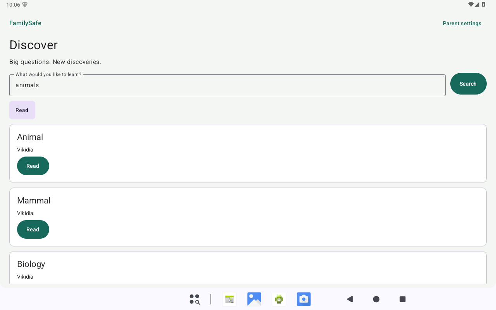
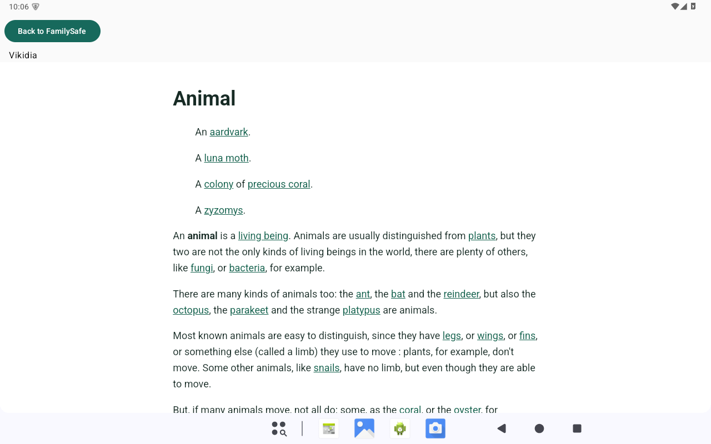

# PR #2 performance review

Historical first performance pass. The subsequent [remaining-blockers review](REMAINING_PERFORMANCE.md) records the identical-key PBKDF2 repair, current measurements, regressions and latest review APK. The figures and artifact below are retained as the earlier baseline.

PR #2 remains **draft and unmerged**. Approval of the actual tablet experience is required before merge. This is one focused performance pass; providers, NASA, search authorization and search implementation are unchanged.

**Performance outcome: improved, still partial.** Cold launch and input drawing improved on the emulator. PIN verification still exceeds the 5-second engineering budget, and article opening remains slow. No physical-tablet experience approval is claimed.

Delivery is for supervised evaluation only. The application is not declared ready for independent child use.

## Before / after on API35

| Measurement | Original UX Fix APK | New review APK |
|---|---:|---:|
| Cold process startup, three attempts | 3/3 timeouts; waits 13.065 / 18.028 / 14.667 s | 3.532 / 2.981 / 2.764 s Android `TotalTime` |
| Isolated existing v1 PIN verification | 22.078 s | 8.366 / 10.690 / 10.128 s |
| Text assignment to draw, ten inputs | median 429.5 ms; range 175–858 ms | median 185.5 ms; range 54–337 ms |
| Actual Animal article opening | 12.001 s | 6.661 s |
| Public queries returning content | 9/10 | 10/10 |

The after cold median is 2.981 s. Before timeouts are **not** completed launch durations, so no cold-start percentage is calculated. The PIN budget failed 3/3 after attempts; the optional acceptance assertion is retained and is not redefined to pass. Five of ten after input draws still exceeded 200 ms. The article comparison is one live observation per build and includes variable network/test/WebView work; it does not prove a transport-specific speedup. Query availability varied without any search-code change.

The same-signature replacement preserved the synthetic legacy settings' exact bytes and timestamp, category/source rules, pending request and individual video review. The existing PIN verified in 9.587 s without writing settings. This is an engineering upgrade fixture, not a read or reset of family settings.

A separate non-debuggable emulator-process probe reproduced the same known 600000-round key using platform HMAC in 5.865 / 5.745 / 6.101 s. It still missed the budget. That diagnostic implementation is **not shipped**. This bounded pass retains the existing standard PBKDF2 implementation and reports the remaining PIN cost for actual-tablet assessment.

## Exact review artifact

| Field | Value |
|---|---|
| APK | `FamilySafe-PR2-Performance-Review.apk` |
| GitHub APK (authorized draft access) | [Download APK](https://github.com/Saifee16/alpha/releases/download/untagged-3e5e8b98b5bb8745948f/FamilySafe-PR2-Performance-Review.apk) |
| GitHub checksum | [Download SHA-256 file](https://github.com/Saifee16/alpha/releases/download/untagged-3e5e8b98b5bb8745948f/FamilySafe-PR2-Performance-Review.apk.sha256) |
| Local APK | `D:\Alpha\familysafe-performance-evidence\FamilySafe-PR2-Performance-Review.apk` |
| Application source commit | `3574ac501712a6d33c51d3f1edab93d9ec6ef70e` |
| APK SHA-256 | `80bf7579806c5a0c2d1e6d73c9018e5d1ade846ff43f420cf2739c15036734bb` |
| Package / version code | `family.safe.debug` / `1` |
| Debuggable | `false`, checked in both copied APK and installed package |
| Certificate SHA-256 | `f88398895f95d7a226ff8a38bd96197686fbf6cf2cf88b3acd1f14836b332444` |
| Build / lint | APK and test APK builds pass; lint 0 errors / 11 warnings |
| Fresh JVM regression | 148 passed, 0 failed/errors/skips in the serial run |

Old APK, new APK and test APK signatures were verified against the same certificate. The installed emulator base APK's SHA-256 also matches the copied review artifact. Later documentation and test-helper commits do not change these application bytes. The earlier debuggable UX Fix APK remains preserved as the baseline.

Only the verified APK and checksum were uploaded to the existing [unpublished draft release](https://github.com/Saifee16/alpha/releases/tag/untagged-3e5e8b98b5bb8745948f), after explicit owner authorization. Both were downloaded again; the APK digest and downloaded checksum match the table. The APK's embedded `META-INF/version-control-info.textproto` revision matches the exact application source commit above. No signing keys, credentials, personal data or device logs were uploaded.

## Repair and compatibility

The review APK disables the debugger runtime through `-PreviewApk=true`, retaining the existing `family.safe.debug` application ID, version code and signing configuration. Ordinary developer builds keep debugging enabled. Shell profiling is available on supported Android versions. No PIN algorithm or data schema changes were made: v1 PBKDF2-HMAC-SHA256 still uses 600000 iterations, 16-byte random salts, 32-byte derived keys and constant-time comparison. There is **no password-hash migration**. Failed-attempt reservation, persisted throttling and background relocking are unchanged.

Build the review artifact with:

```powershell
$env:JAVA_HOME='D:\Alpha\tools\jdk\jdk-17.0.20.1+1'
$env:GRADLE_USER_HOME='D:\Alpha\tools\gradle-cache'
.\gradlew.bat cleanTestDebugUnitTest testDebugUnitTest assembleDebug assembleDebugAndroidTest lintDebug '-PreviewApk=true' --offline --max-workers=1
```

Copy the resulting APK before another build: a normal developer build overwrites the same `app/build/outputs/apk/debug/app-debug.apk` path. Verify the package, absence of the debuggable flag and certificate on the copied artifact. Android's [performance guidance](https://developer.android.com/topic/performance/measuring-performance) explains the debugger's performance cost; the measurements below determine its effect here.

## Method and original build observations

Measurements use the existing API35 ranchu emulator, a guarded public engineering PIN and predetermined educational queries. Three `am force-stop` / `am start -W` launches measure fresh processes separately from PIN derivation. These are cold app processes with a running Android system, not device reboots. No builds ran during the settled before/after measurement batches. UI input measurements span text-state assignment to draw; article observations include test synchronization, WebView work and live network latency. They are not isolated renderer/network benchmarks. Household PINs, settings or searches were not measured or logged.

The isolated original-build public PIN verification took **22078 ms** (provider BC). A second diagnostic measured equivalent HMAC work at 18199 ms and production verification at 27881 ms, with equal derived keys; its 5000 ms budget assertion failed as expected. This did not justify shipping a custom cryptographic implementation. Both diagnostics are retained as evidence.

The settled original-build cold batch timed out 3/3 times, with waits **13065, 18028, 14667 ms**; none supplies a valid Android `TotalTime`. An earlier batch recorded one 12579 ms launch and two timeouts. Keep those preliminary observations, but do not treat timeouts as completed launch durations. Android frame diagnostics also showed long initial traversal/draw stalls. A sampled method-trace attempt produced an empty file and is not usable CPU-profile evidence.

The original-build ten-query/article test passed. Nine queries returned content; `continents` returned zero in that batch. Input state updates were 0–28 ms, draw feedback **175–858 ms** (median 429.5 ms), and actual Animal article opening took **12001 ms**. This is a variable emulator/network baseline, not a physical-tablet prediction.

Raw evidence is kept outside Git under `D:\Alpha\familysafe-performance-evidence`. Only public fixture screenshots are included in this document.

## Verification history

The first fresh review build ran 148 JVM tests: 146 passed and two existing `ChildSearchStateTest` methods failed. `newSearchCannotBeOverwrittenByPreviousGeneration` failed its one-second worker-entry assertion; `cancelledOrIneligibleLateResponseCannotPublish` checked completion after a fixed 100 ms delay. The full parallel build took 11m37s. Those failures and their stack traces are retained in `initial-review-build-failed.txt` / `initial-unit-failures.xml`. A fresh serial run passed all 148 tests without changing search code or those tests; the entire serial build/lint gate passed in 10m20s. These waits remain sensitive to machine load.

The actual ten-query/article/Back device test passed before and after. Existing-record replacement verification passed. Independent read-only review found no Critical/Important issue with package/signing identity or the emulator-only guards. API26 device testing and physical-tablet testing were not run. The profileable manifest element is ignored by older Android versions, but source compatibility inspection does not replace installation testing.

The selected device regression batch enumerated 36 cases: **29 passed, 6 skipped, 1 failed** in 1187.992 s. Passing cases cover wrong-PIN throttling through recreation, background authentication completion, parent relocking, saved settings, denied queries, stale actions, explicit reading consent, browser escape/transport restrictions, and existing video lock/revoke/rotation boundaries. Six opt-in live cases were skipped because their individual consent flags were absent; this batch does not claim those live scenarios passed. The separate opted-in ten-query/article test above did run.

The failure was `ArchiveReviewFlowTest.lateFixtureDiscoveryCannotCrossParentLockOrApproveItself`: after its initial locked/late-callback assertions, the helper tried `performScrollTo()` on the fixed home-header parent entry, which has no scroll ancestor. The test helper now selects the existing `parent-entry` tag and clicks it directly. After rebuilding/installing **only the test APK**, the complete affected case passed in **49.357 s**. The original failing batch is retained; this is 30 distinct selected scenarios passing across the batch and focused rerun, not a clean repeat of all 36. The application APK was neither rebuilt nor replaced for that test fix and retains the source commit and SHA-256 listed above.

## Public fixture screenshots

The two builds present the same interface. These are actual emulator captures, inspected at full size; screenshot protection was overridden only inside explicitly guarded disposable-emulator tests and restored afterward.

| Original | Review APK |
|---|---|
|  |  |
|  |  |

The article screenshots show [Animal by Vikidia contributors](https://en.vikidia.org/wiki/Animal), under [CC BY-SA 3.0](https://creativecommons.org/licenses/by-sa/3.0/), rendered in FamilySafe's restricted reader. These captures contain no family configuration or household query.

## Tablet handoff

The physical tablet was not connected during this pass; the final device inventory also contained only `emulator-5560`. No family hardware was installed, reset or instrumented. The [physical-device checklist](PHYSICAL_DEVICE_CHECKLIST.md) still applies: compare the installed package/certificate with this exact APK, retain the previous UX Fix APK, and use an in-place `adb install -r` only. Do not uninstall, clear storage or change signing keys. The preserved UX Fix baseline uses the same record format and catalog; there is no hash migration to reverse. Earlier V1 pilot rollback has separate catalog restrictions documented in [UX_FIX_PILOT.md](UX_FIX_PILOT.md).

On the actual tablet, an adult still needs to check cold launch, existing PIN latency, a rejected PIN and throttle, saved settings/requests/individual reviews, real touch input, article reading/Back, rotation and background relocking. Do not run the resetting emulator instrumentation on that device. This review supplies no tablet approval or merge authorization.
