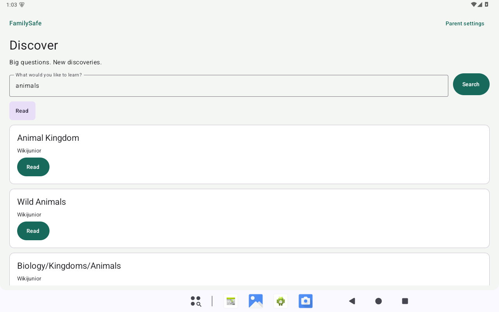
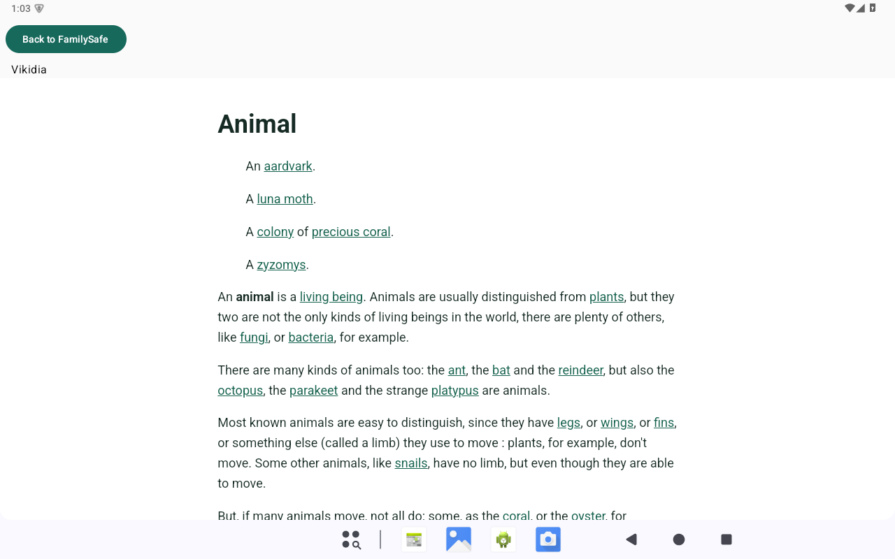

# Remaining performance blockers — evidence record

Status (2026-10-19): a measured PIN-backend improvement is delivered for supervised review. First-use PIN and article delay remain material; tablet approval is still required. PR #2 stays draft and unmerged, and main is unchanged. No independent-child-use readiness is declared.

## Before / after on the same emulator

Baseline is the previous non-debuggable review APK (`80bf7579…`); candidate is `b3118f14…`. Both retain package, signing identity, v1 fixture and review build settings. This pass changes only the PIN derivation backend in production. No cold-launch, article or input speedup is attributed to that change.

Cells show **median (minimum–maximum; nearest-rank p90)**. Each distribution is small, sequential and subject to host/network variability; p90 is observation `ceil(0.9 × n)` after sorting, not a confidence bound. Times include only completed attempts. Matched synthetic settings, identical API35 emulator configuration and no concurrent builds were used for these batches.

| Operation | Samples | Before | Candidate |
|---|---:|---:|---:|
| Cold process launch, s | 10 each | 3.984 (2.910–4.895; 4.705) | 3.536 (2.992–4.560; 4.074) |
| Actual PIN unlock, s | 10 each | 15.133 (11.868–23.655; 23.410) | 4.685 (3.915–9.439; 6.062) |
| All article opens, s | 10 each | 3.428 (2.895–15.308; 6.940) | 2.385 (2.049–10.440; 2.651) |
| Article opens after the first, s | 9 each | 3.423 (2.895–6.940; 6.940) | 2.367 (2.049–2.651; 2.651) |
| Empty-state edit to measured draw, ms | 10 each | 123.5 (80–239; 223) | 46 (35–288; 111) |
| Edit clearing one rendered result, ms | 10 each | 416.5 (131–999; 727) | 100.5 (48–156; 147) |

Both cold batches completed 10/10 starts. Cold means a force-stopped app process followed by Android `am start -W` **TotalTime**, not reboot, filesystem-cache eviction or final settings/input readiness. PIN unlock uses the actual existing-record authentication path, including durable attempt reservation, derivation and successful save; it excludes human PIN entry time. First candidate unlock was **9.439 s**, and **4/10** unlocks exceeded 5 s; a median improvement does not remove the first-use problem.

First article opens in the fresh instrumentation process were **15.308 → 10.440 s**; both article batches completed 10/10, with Back restoring the query. Article timings include Compose interaction/test synchronization and require visible WebView, progress 100, exact URL/title and content height. These are full-query replacement/input draw measurements, not physical key/IME-to-display measurements. Faster article/input observations with unchanged code show the size of uncontrolled environment effects.

The isolated production verifier went **14.987 → 3.838 s**, correctly verifying the same 600000-round v1 record. The existing optional **5000 ms** assertion failed before and passed in the candidate batch. A subsequent immediate old→new confirmation used the same installed test APK, device and public fixture, replacing only the application APK in place:

| Isolated verifier confirmation | Three samples, ms | Median, ms | Existing 5000 ms budget |
|---|---|---:|---:|
| Previous APK | 9542, 9103, 8122 | 9103 | 0/3 pass |
| Candidate APK | 3975, 4880, 4239 | 4239 | 3/3 pass |

All six confirmations verified the same derived key at 600000 rounds. Same-signature old/new replacement also preserved the exact legacy fixture. This short control supports a backend improvement while leaving JIT, scheduler and device differences unresolved. The candidate was restored afterward. **Physical tablet and API26 runtime testing: NOT RUN; only the API35 ranchu emulator was accessible.**

## Provider investigation

Before this pass, private `PinSecurity.derive` used JCA `SecretKeyFactory.getInstance("PBKDF2WithHmacSHA256")` with an ASCII digit PIN, 16-byte salt, 600000 iterations and a 256-bit result. The API35 emulator resolves this to provider **BC**, class `com.android.org.bouncycastle.jcajce.provider.symmetric.PBEPBKDF2$PBKDF2WithHmacSHA256UTF8`.

A public known-answer fixture was derived five times in a non-debuggable shell process, without Activity/settings/rendering work. Wall times were **12207, 10247, 9141, 13979, 9069 ms**; thread CPU times were **11557, 9724, 8396, 12248, 8253 ms**. All derived keys matched the independent Python hashlib value. The high CPU/wall ratio establishes derivation work as a separate bottleneck.

A separate 1 ms sampled ART method trace captured the same JCA provider call. The trace was nonempty (59170 bytes), did not overflow, and covered 9605.588 ms of reconstructed main-thread CPU time. Approximate exclusive shares were `NativeCrypto.EVP_DigestFinal_ex` 55.91%, `EVP_DigestUpdate` 23.68%, and `EVP_DigestInit_ex` 3.67%. The stack passes through platform BC HMac/PKCS5S2, OpenSSLDigest, MessageDigest and Conscrypt. These are sampled attribution estimates; they do **not** measure pure JNI overhead separately from native hash work. They demonstrate repeated digest-boundary work inside the existing derivation, not an Activity or disk bottleneck.

## Maintained alternatives

| Candidate | Compatibility and trade-off | Decision |
|---|---|---|
| Platform JCA PBKDF2 | Existing v1 result; baseline above | Control |
| Conscrypt JCA provider | Its [published capabilities](https://github.com/google/conscrypt/blob/master/CAPABILITIES.md) provide HMAC/digests but list only DESEDE under SecretKeyFactory, with no PBKDF2 factory | No provider-name shortcut |
| Upstream Bouncy Castle lightweight PBKDF2 | Maintained [official distribution](https://www.bouncycastle.org/download/bouncy-castle-java/); `PKCS5S2ParametersGenerator(SHA256Digest())` computes the same derivation without changing global JCA provider order. Adds a cryptographic dependency and APK bytes; requires updates and compatibility checks | Selected; verified in the actual app |
| Platform native HMAC in a Java PBKDF2 loop | Earlier diagnostic produced equal keys but still took 5.745–6.101 s and would add app-owned cryptographic iteration code | Do not ship |
| Native wolfCrypt JNI/JCE | [Supported Android examples](https://github.com/wolfSSL/wolfssl-examples/tree/master/android) and [maintained JNI implementation](https://github.com/wolfSSL/wolfcrypt-jni); introduces native build/ABI, library updates and licensing decisions | No native integration in this bounded change |

The upstream candidate used **bcprov-jdk15to18 1.86**, the current official Java 1.5–1.8-compatible distribution at investigation time. Downloaded JAR SHA-256 `fc50334d4d87b4272e72fa95ca748ead05bdef02ef760a5b13f64ffee317cd81` matches Maven Central metadata. The five same-key probe times were **6314, 5515, 5722, 3528, 3966 ms**, CPU **6228, 5506, 5724, 3516, 3967 ms**. Median probe time fell from 10247 to 5515 ms; some candidate runs still missed the existing 5000 ms engineering budget. This probe is separate from actual PIN-unlock distributions and is insufficient by itself to declare tablet performance acceptable.

No new PIN format is justified by identical derived keys. A backend substitution can read existing v1 records without rewriting them or asking the parent to change PIN. No authenticated migration is proposed or implemented. Lowering iterations, bypassing persisted throttling, caching successful PINs/derived keys, reflection into hidden Android crypto APIs, and global security-provider replacement are excluded.

The candidate's only production changes are the pinned dependency in `app/build.gradle.kts` and the private derivation body/imports in `settings/PinSecurity.kt`. UTF-8 preserves the existing password encoding because accepted PINs contain only ASCII digits. Temporary password bytes are zeroed after derivation; the upstream generator is local to the call. Verification parsing, random salt generation, constant-time comparison, authentication lifecycle and persistence remain the existing implementations. No long-lived PIN/key cache is introduced.

Security trade-off: offline guessing work is unchanged, since attackers can already implement the same PBKDF2 efficiently. Legitimate verification and early online wrong-PIN attempts lose incidental provider overhead; the explicit persisted throttle schedule is unchanged. The dependency adds update/maintenance responsibility and increases the final APK from 8013943 to 10272724 bytes (+2258781 bytes, 28.2%). This is not a claim of FIPS validation.

## Article/input investigation

Article transport and validation run in the hardened WebView interception thread. Existing evidence shows a 2774 ms HWUI frame during Animal opening, with about 2732 ms between draw-command issue and SwapBuffers but 5.7 ms from traversal to draw. EGL configuration and tile-memory warnings also appear. This identifies a substantial emulator rendering/submission stall; it does not isolate GPU execution from host scheduling or prove a DOM/network cause.

The old 6661 ms article metric includes Compose interaction/synchronization and waits for visible WebView, progress 100, matching title/URL and sufficient content height. The old 185.5 ms input median mostly measures full-query replacement while clearing previous results, rather than steady individual-key typing. The new opt-in measurements separate actual production article opens, empty-state versus results-clearing edits, hardened reader construction, fetch/interception return and visible drawing. Deterministic HTML through the existing test fetch seam isolates renderer/factory overhead from live transport. Production policy, CSP, cache behavior, WebView lifecycle and search cancellation stay intact unless later evidence demonstrates a specific repair.

The unchanged production-UI baseline completed ten Animal opens: **15308, 3423, 4739, 3432, 3637, 3125, 2895, 3309, 6940, 3171 ms**. First open was 15308 ms; the following nine had median **3423 ms**, range **2895–6940 ms**. Actual existing-record PIN unlocks, including durable reservation and successful save, took **23655, 23410, 19995, 15252, 17564, 15014, 13455, 13940, 11868, 12023 ms** (median **15133 ms**). These current-session distributions show more delay than the earlier pass and must be compared with the same current-session controls, not mixed into a favorable cross-session percentage.

Empty-state text edits had median **123.5 ms** to the measured draw versus **416.5 ms** when clearing one rendered result. State assignment took **0–31 ms**. The draw metric does not separate scheduler, composition, layout and CPU drawing, and does not measure final screen presentation. Existing stale-action removal remains mandatory.

### Reader controls

Twenty controls per build used the same hardened WebView factory: ten tiny deterministic pages followed by ten live Animal pages. The live control is already renderer-warm and is distinct from the first production article open. All 40 controls completed with matching URL/title; all live responses were HTTP200. WebView was `124.0.6367.219`, hardware acceleration true, layer type 0, view 1280×800.

| Phase median, ms (10 each) | Before | Candidate |
|---|---:|---:|
| Tiny local HTML: construct | 42.5 | 65.5 |
| Tiny local HTML: response to first visible draw | 1095 | 1042.5 |
| Live Animal: construct | 53 | 44.5 |
| Live Animal: validated HTML ready | 310.5 | 381.5 |
| Live Animal: response to first visible draw | 868 | 551.5 |
| Live Animal: complete observed | 2709.5 | 2724.5 |

Rendering/observing completion remains material even with tiny HTML and no network work. The control does not isolate composition, GPU execution or host scheduling. Empty-state input assignment was 0 ms in the candidate; clearing a rendered result was 0–1 ms, while measured draws took longer. The results support retaining immediate stale-action removal and investigating device rendering separately. **No browser policy/CSP/cache change, DOM stripping, GPU toggle, prewarming, or working search/input refactor is shipped.**

## Measurement controls and retained diagnostics

All measurements use public synthetic fixtures on the ranchu API35 emulator. Resetting instrumentation rejects physical hardware and requires `disposableInstrumentation=true`, the exact debug package and a debug build type. Live diagnostics also require explicit opt-in. No family PIN, settings or query is profiled or logged. Raw evidence remains local under `D:\Alpha\familysafe-blockers-evidence`; device logs are not uploaded.

An initial cold-launch batch encountered severe variability/timeouts while the Windows host had about 2 GB free and idle Gradle processes held roughly another 2 GB. It is retained separately under `before-host-pressure`. The workspace's idle Gradle daemon was stopped, freeing memory before a fresh baseline. Neither comparable measurement batch ran alongside a build. No timeout is counted as a completed launch or converted into a speedup percentage.

The initial reader phase harness was denied by production policy before fetch because its fixture omitted the required community-source consent flag. Its 62786 ms non-completion is retained as a **test-harness failure**, not an article transport measurement. The corrected fixture uses explicit consent and verifies URL/title identity and response status. The small final log capture covered later PIN tests rather than the input/article sample interval; it cannot establish causality for those JSON measurements.

## Validation and exact changes

- Application source commit: [`252c809c00511aa1eabf857c9c3e48638cb49bc0`](https://github.com/Saifee16/alpha/commit/252c809c00511aa1eabf857c9c3e48638cb49bc0). Production diff: one pinned dependency in `app/build.gradle.kts`; three imports and the private derivation body in `settings/PinSecurity.kt`. `MainActivity`, throttle/store, child UI, browser, search and provider/NASA code are unchanged by this continuation.
- `PinSecurityTest.kt` adds two tests: independent fixed v1 vectors (ordinary, leading-zero and 32-digit PIN), wrong PIN/unsupported version/round-count rejection, plus a new random-salt record checked against standard JCA. **150 JVM tests passed, 0 failures/errors/skips** across the full suite.
- Fresh full gate passed: `testDebugUnitTest assembleDebug assembleDebugAndroidTest lintDebug -PreviewApk=true`, serial worker/in-process Kotlin. **Lint: 0 errors/Fatal, 18 warnings** (8 SetTextI18n, 7 dependency/tool-version notices, and one each UnusedAttribute, SetJavaScriptEnabled, ViewConstructor). Warnings were retained, not suppressed.
- A source-metadata refresh first triggered redundant lintVital work and was cancelled; it is not claimed as a pass. The subsequent exact-source application/test packaging passed with only duplicate lintVital tasks excluded, after the full lint gate above had passed. Embedded revision, final signature and application source equality were then verified.
- Final selected device batch: **24 passed, 0 failed, 0 skipped**, `633.969 s`; classes `FamilyFlowTest`, `BrowserDeviceTest`, `RescueExperienceTest`, with live reading explicitly enabled. Covers wrong-PIN throttle/recreation, background authentication, parent relocking, persistence, source consent, stale clicks/result clearing, article/Back, browser restrictions and ten live reading queries. Existing NASA/video fixture assertions are regression coverage; no new integrations or NASA development occurred.
- Separate performance tests passed (ten actual unlocks, twenty input edits, ten production article/Back loops, twenty reader controls). The original failing baseline budget and diagnostic harness errors remain recorded locally; they are not counted as candidate passes.
- Same-signature upgrade of the public engineering fixture preserved **exact settings bytes and timestamp**, categories, source consent, blocks, requests and approved-video data. Existing v1 PIN verified in **4.473 s** without writing settings. Old→new confirmation also retained that fixture. No household data was read or reset.
- Two-stage guarded process-interruption check passed: the correct-PIN attempt persisted failure reservation 10 while authentication was pending; the driver force-stopped the emulator process and confirmed it gone; the restarted process denied the correct PIN during the saved deadline without changing file bytes. Marker-to-force-stop was **1750 ms**. This validates interrupted pending authentication, not an exact instruction inside the hash loop. Stage one is intentionally terminated, not reported as a successful test.
- Independent source/security review found no Critical/Important production defect. It identified an interruption-test false-positive before execution: using a wrong PIN would preserve the reservation even after completed verification. The executed test uses the correct PIN so completed success would clear it and fail the restart assertions.

New `PerformanceBlockersDeviceTest.kt` holds opt-in public-fixture distributions/phase measurements; new `PinInterruptionDeviceTest.kt` holds the guarded two-stage check. `PinPerformanceDeviceTest.kt` labels the platform-provider metadata separately from the measured production verifier. Later test/documentation commits do not alter application source or the delivered APK.

## Verified review artifact

| Field | Value |
|---|---|
| Download | [Review APK](https://github.com/Saifee16/alpha/releases/download/untagged-3e5e8b98b5bb8745948f/FamilySafe-PR2-PBKDF2-Review.apk) · [SHA-256 file](https://github.com/Saifee16/alpha/releases/download/untagged-3e5e8b98b5bb8745948f/FamilySafe-PR2-PBKDF2-Review.apk.sha256) (existing unpublished GitHub draft; authenticated access required) |
| Local APK | `D:\Alpha\familysafe-blockers-evidence\FamilySafe-PR2-PBKDF2-Review.apk` |
| SHA-256 | `b3118f1404e6d40ea18fc70446887fb8722ff624a22ed9a94332e6c940c32f9f` |
| Size | 10272724 bytes |
| Exact embedded source revision | `252c809c00511aa1eabf857c9c3e48638cb49bc0` |
| Package / versions | `family.safe.debug`, versionCode 1, versionName 0.1.0; minSdk26, targetSdk36 |
| Debuggable | false (`-PreviewApk=true`) |
| Signing-certificate SHA-256 | `f88398895f95d7a226ff8a38bd96197686fbf6cf2cf88b3acd1f14836b332444` — same existing signing identity; APK Signature Scheme v2 verified |
| Installation | In-place `adb install -r`; installed APK hash matched the local candidate, including restoration after the old/new check |

Only the verified APK and checksum were added to the existing draft release. Both were downloaded again and compared with the local APK/checksum; GitHub asset digest also matched. Earlier assets were retained. No device logs, signing keys, credentials or personal data were uploaded, and the release was not published. Raw public-fixture evidence, traces, driver scripts and `timings-summary.json` remain local under `D:\Alpha\familysafe-blockers-evidence`.

## Public-fixture screenshots

The current candidate retained the child Discover/results and reader UI:

Article content: [Animal, Vikidia](https://en.vikidia.org/wiki/Animal), community contributors, [CC BY-SA 3.0](https://creativecommons.org/licenses/by-sa/3.0/), shown in the application reader for this public engineering fixture. Screenshots contain no household credentials or personal queries. They demonstrate UI retention, not a content-suitability or child-safety certification.

**Merge remains blocked on the owner's approval of the actual tablet experience.** First-use PIN, slow first article rendering, physical-tablet performance and API26 runtime compatibility remain explicit limits. Delivery is for supervised testing only.
